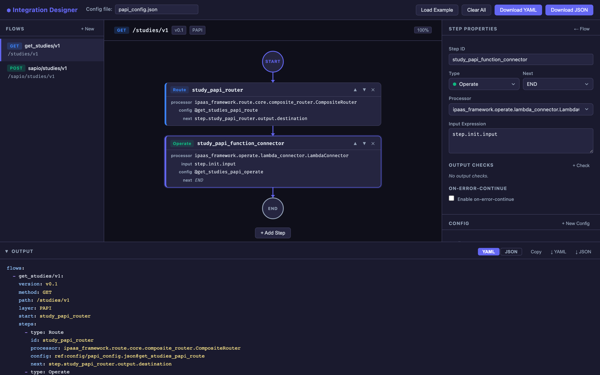
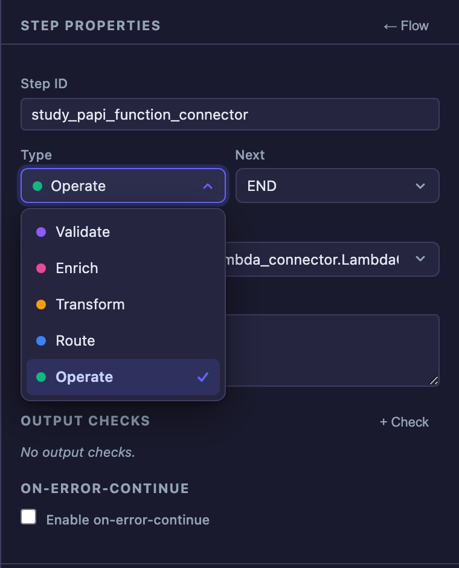
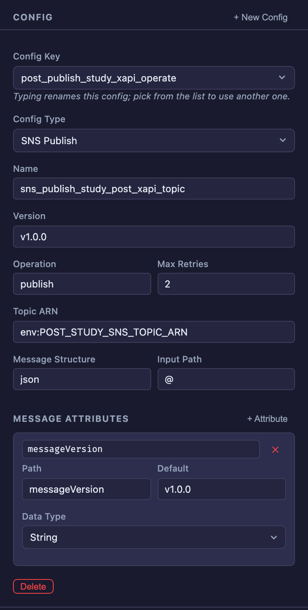
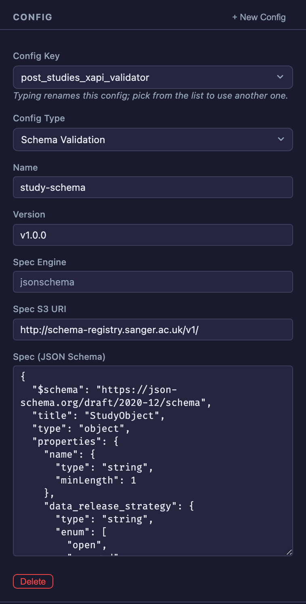
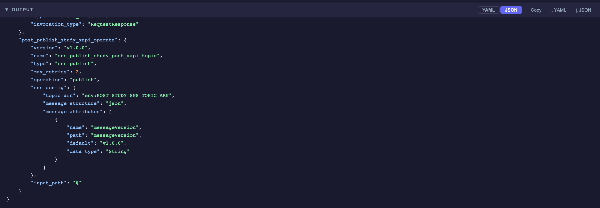
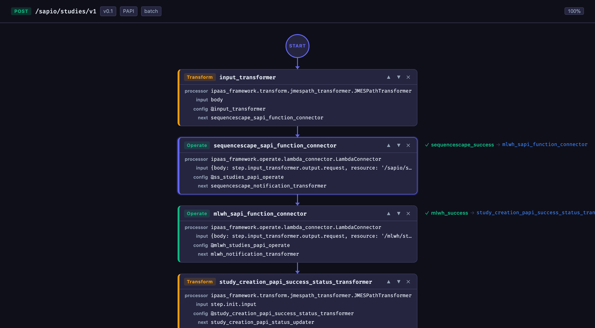

# Integration Designer

[](https://github.com/dasunpubudumal/integration-designer/actions/workflows/unit-tests.yml)
[](https://github.com/dasunpubudumal/integration-designer/actions/workflows/integration-tests.yml)


A browser-based visual designer for authoring iPaaS integration flows. You build each flow as a pipeline of steps on a canvas, fill in each step's settings and config in a side panel, and the app generates the two files the iPaaS framework needs:

- **A YAML DSL file** that defines the flows and their steps.
- **A companion JSON config file** that holds the configuration each step references.

Both outputs update live as you edit, and you can copy or download them at any time.



## Contents

- [Features](#features)
- [Setting up](#setting-up)
- [Using the designer](#using-the-designer)
- [Step types](#step-types)
- [Config types](#config-types)
- [What it generates](#what-it-generates)
- [Customising processor suggestions](#customising-processor-suggestions)
- [Testing](#testing)
- [Continuous integration](#continuous-integration)
- [Project structure](#project-structure)
- [Troubleshooting](#troubleshooting)
- [Tech stack](#tech-stack)

## Features

- Visual pipeline canvas with zoom (mouse wheel) and pan (drag the background).
- Five step types (Validate, Enrich, Transform, Route and Operate), colour-coded on the canvas.
- Type-specific config forms for routers, Lambda, HTTP, JMESPath mappings, JSON Schema validation, SQS, SNS, DynamoDB and mocks.
- Every new step gets its own config automatically. Configs can also be shared between steps.
- Conditional branching (`output.checks`), `on-error-continue` handling and batch execution.
- Live, syntax-highlighted YAML and JSON output with copy and download.
- Work is saved in the browser automatically, so a refresh doesn't lose anything.

## Setting up

### Prerequisites

- **Node.js** 24 (the version in `.nvmrc`). Node 18, or 20 and later, also works, but CI runs on 24. Check with `node -v`.
- **npm**, which comes with Node.js.
- A modern browser (current Chrome, Edge, Firefox or Safari).

### Install and run

```bash
git clone https://github.com/dasunpubudumal/integration-designer.git
cd integration-designer
nvm use            # optional: switches to the Node version in .nvmrc
npm install
npm run dev
```

If you use [nvm](https://github.com/nvm-sh/nvm) and don't have Node 24 yet, run `nvm install` first.

Then open **http://localhost:3000**. The dev server reloads the page as you change the source.

### Production build

```bash
npm run build     # outputs static files to dist/
npm run preview   # serves dist/ at http://localhost:3000
```

`dist/` is a plain static site, so it can be hosted on any static web server (S3, nginx, GitHub Pages and so on). No backend is needed. `dist/` isn't committed; CI builds it (see [Continuous integration](#continuous-integration)).

### Available scripts

| Script | What it does |
|--------|--------------|
| `npm run dev` | Starts the Vite dev server on port 3000 with hot reload |
| `npm run build` | Builds the production bundle into `dist/` |
| `npm run preview` | Serves the built `dist/` folder on port 3000 |
| `npm test` | Runs all unit and integration tests once |
| `npm run test:unit` | Runs only the unit tests |
| `npm run test:integration` | Runs only the integration tests |
| `npm run test:watch` | Runs the tests in watch mode, re-running on each change |

To use a different port, change `server.port` and `preview.port` in `vite.config.js`.

## Using the designer

### Layout

```
┌─ Top bar ───────────────────────────────────────────────────────────────────┐
│ ⬢ Integration Designer   Config file: [papi_config.json]                    │
│                   [Load Example] [Clear All] [Download YAML] [Download JSON]│
├─ Flows ──────────┬─ Canvas ─────────────────────────────┬─ Editor ──────────┤
│ [+ New]          │ GET /studies/v1  v0.1  PAPI     100% │ Flow / Step       │
│                  ├──────────────────────────────────────┤ properties        │
│ ► get_studies/v1 │            ○ START                   │                   │
│   post_studies   │               │                      │ Config            │
│                  │      ┌──────────────────┐            │ [+ New Config]    │
│                  │      │ Route            │            │ key, type and     │
│                  │      │ study_router     │            │ type-specific     │
│                  │      └──────────────────┘            │ fields            │
│                  │               │                      │                   │
│                  │            ○ END                     │                   │
│                  │        [+ Add Step]                  │                   │
├──────────────────┴──────────────────────────────────────┴───────────────────┤
│ ▼ Output   [YAML] [JSON]                        [Copy] [↓ YAML] [↓ JSON]    │
│ live, syntax-highlighted preview                                            │
└─────────────────────────────────────────────────────────────────────────────┘
```

### Quick start: explore the example

1. Click **Load Example** in the top bar. This replaces your current work with a set of sample study flows.
2. Pick a flow in the **Flows** sidebar to show it on the canvas.
3. Click a step card to see and edit its properties and config in the **Editor** panel.
4. Watch the **Output** panel at the bottom update as you make changes.

### 1. Create a flow

1. Click **+ New** at the top of the Flows sidebar.
2. Fill in:
   - **Flow Name**, for example `get_studies/v1`. This becomes the flow's key in the YAML.
   - **Method**: GET, POST, PUT, PATCH or DELETE.
   - **Version**, for example `v0.1`.
   - **Path**, for example `/studies/v1`.
   - **Layer**, for example `PAPI`, `SAPI` or `XAPI`.
3. Click **Create**. The new flow is selected and shown on the canvas.

To change these later, select the flow and edit them in the **Flow Properties** panel. That's also where you set:

- **Start Step**, the step the flow begins with. It's set to the first step automatically.
- **Batch Execution**, which runs the pipeline once per record of an array in the payload. See [Batch execution](#batch-execution).

To delete a flow, hover over it in the sidebar and click **✕**.

### 2. Add steps

Click **+ Add Step** under the pipeline. Each new step:

- gets an ID such as `step_3`, defaults to the **Operate** type and points `next` to `END`;
- is linked from the previous last step, if that step pointed to `END`;
- gets its **own new config**, keyed after the step ID.

Use the **▲ / ▼** buttons on a card to reorder steps, and **✕** to delete one.

### 3. Edit a step

Click a step card to open **Step Properties**:

| Field | Meaning |
|-------|---------|
| **Step ID** | The step's `id` in the YAML. Other steps use it in `next`. |
| **Type** | Validate, Enrich, Transform, Route or Operate. |
| **Next** | The step to run afterwards, or `END`. Pick from the list or type an expression, for example `step.my_router.output.destination`. |
| **Processor** | The processor class. The list suggests processors for the chosen type, but you can type any class path. |
| **Input Expression** | Optional input mapping, for example `step.init.input` or `{body: step.x.output}`. |
| **Output Checks** | Optional named conditions that branch to other steps. See [Conditional branching](#conditional-branching). |
| **On-Error-Continue** | Optional exception handling. See [On-error-continue](#on-error-continue). |

Click **← Flow** to go back to the flow's properties.

<p align="center">
  
</p>

### 4. Configure the step

The **Config** section below the step properties edits the JSON config block that the step references.

- **Config Key** is the block's key in the JSON file.
  - **Typing** renames the step's config. The JSON and the YAML reference update as you type. If several steps share the config, all of them follow the rename.
  - **Picking from the list** switches the step to an existing config.
  - If you type a key that already exists, nothing is overwritten. A hint appears, and clicking out of the field switches the step to that existing config.
- **+ New Config** creates a fresh config for the step and links it straight away. The config type is guessed from the step's processor (for example, `SNSConnector` gives **SNS Publish**), and the key is selected so you can type a name over it.
- **Config Type** chooses the form shown below it. See [Config types](#config-types).
- **Delete** removes the config block and unlinks the step.

Every change is reflected in the output immediately; there's no save button.

<table>
  <tr>
    <td align="center"></td>
    <td align="center"></td>
  </tr>
  <tr>
    <td align="center"><em>SNS Publish config</em></td>
    <td align="center"><em>Schema Validation config</em></td>
  </tr>
</table>

### 5. Get the output

The **Output** panel at the bottom shows both files live:

- Switch between **YAML** and **JSON** with the tabs.
- **Copy** copies the visible file to the clipboard.
- **↓ YAML** and **↓ JSON**, or **Download YAML** / **Download JSON** in the top bar, save the files.
- Drag the panel's top edge to resize it, or click its title bar to collapse it.



The **Config file** name in the top bar is used both as the JSON download's file name and in every step's config reference (`ref:config/<file name>@<key>`). The YAML downloads as `study-papi-config.yaml`.

### Canvas controls

| Action | How |
|--------|-----|
| Zoom in or out | Scroll the mouse wheel (or pinch on a trackpad) over the canvas. Zoom centres on the cursor and ranges from 25% to 250%. |
| Reset zoom | Click the percentage at the right of the flow header. |
| Pan | Click and drag on empty canvas background, or use the scrollbars. |
| Select a step | Click its card. |

The flow header (method, path, version and layer) stays fixed while you zoom and pan.



### Saving your work

Your work is saved to the browser's `localStorage` on every change and restored when you reload the page. Things to bear in mind:

- It's stored **per browser and per machine**. To move work elsewhere or share it, download the YAML and JSON files.
- Clearing your browser's site data deletes it.
- **Clear All** in the top bar removes all flows and configs after asking you to confirm.
- **Load Example** replaces your current work. If you already have flows, it asks you to confirm first.

## Step types

| Type | Purpose | Colour |
|------|---------|--------|
| **Validate** | Checks incoming data, for example against a JSON Schema | Purple |
| **Enrich** | Adds data to the payload from another source | Pink |
| **Transform** | Reshapes data, for example with a JMESPath expression | Amber |
| **Route** | Picks the next step by evaluating rules | Blue |
| **Operate** | Calls an external system: Lambda, HTTP, SQS, SNS or DynamoDB | Green |

### Conditional branching

A step can declare `output.checks`: named predicates that send execution to a different step when they're true. The step's own `next` is used when no check matches.

```yaml
output:
  value: "@"
  checks:
    sequencescape_success:
      predicate: "data!=null && data.statusCode!=null && (data.statusCode==`200`||data.statusCode==`201`)"
      next: mlwh_sapi_function_connector
next: sequencescape_notification_transformer
```

Add checks with **+ Check** in the step editor. The canvas shows each check beside its step as `✓ check_name → destination`.

### On-error-continue

A step can catch named exceptions and continue at another step instead of halting the flow. Tick **Enable on-error-continue** in the step editor:

```yaml
on-error-continue:
  exceptions: ["Exception"]
  next: study_creation_papi_dlq_connector
```

### Batch execution

A flow can run in batch mode. The framework splits an array from the incoming payload and runs the pipeline once per record. Tick **Batch Execution** in the flow properties:

```yaml
execution:
  type: batch
  batch_input_path: body.Records
```

## Config types

| Config Type | `type` in JSON | Key fields |
|-------------|----------------|------------|
| Route | `route` | `rules`: a map of `{ field, value, destination }` |
| Lambda Function | `lambda_function` | `invocation_type` (`RequestResponse` or `Event`) |
| HTTP Connector | `http_connector` | `provider_key`, `raw_auth_config` (OAuth2 client credentials, bearer, basic or none), `max_retries`, `timeout` |
| Mapping (JMESPath) | `mapping` | `engine: jmespath`, `spec` |
| Schema Validation | `schema` | `spec_engine: jsonschema`, `spec_s3_uri`, `spec` |
| SQS | `sqs` | `operation`, `queue_name` |
| SNS Publish | `sns_publish` | `max_retries`, `operation`, `sns_config` (`topic_arn`, `message_structure`, `message_attributes`), `input_path` |
| DynamoDB | `dynamodb` | `operation`, `partition_key`, `sort_key`, `table_name`, `region_name` |
| Mock | `mock` | `file`: path to a mock response JSON |

Notes:

- **Schema Validation:** type or paste the JSON Schema as normal, formatted JSON. It's written to the config as a single-line string, which is what the framework expects. If the JSON is invalid, a warning appears and the text is saved exactly as typed.
- **SNS Publish:** add message attributes with **+ Attribute**. Each has a name, a path, a default and a data type (`String`, `String.Array`, `Number` or `Binary`).
- Values such as `env:QUEUE_NAME` or `sm:secret-name.key` are passed through unchanged, for the framework to resolve at runtime.

## What it generates

### YAML DSL

Describes one or more flows. Each flow is a pipeline of steps, run from its start step through to `END`.

```yaml
flows:
  - get_studies/v1:
    version: v0.1
    method: GET
    path: /studies/v1
    layer: PAPI
    start: study_papi_router
    steps:
      - type: Route
        id: study_papi_router
        processor: ipaas_framework.route.core.composite_router.CompositeRouter
        config: ref:config/papi_config.json@get_studies_papi_route
        next: step.study_papi_router.output.destination

      - type: Operate
        id: study_papi_function_connector
        processor: ipaas_framework.operate.lambda_connector.LambdaConnector
        input: step.init.input
        config: ref:config/papi_config.json@get_studies_papi_operate
        next: END
```

### JSON config

A flat object. Each key is a config block that steps reference from the YAML with `ref:config/<file name>@<key>`. One block can be shared by several steps across several flows.

```json
{
  "get_studies_papi_route": {
    "version": "v1.0.0",
    "name": "study-router-schema",
    "type": "route",
    "rules": {
      "study-api-get": { "field": "httpMethod", "value": "GET", "destination": "study_papi_function_connector" }
    }
  },
  "get_studies_papi_operate": {
    "version": "v1.0.0",
    "name": "studies-system",
    "type": "lambda_function",
    "invocation_type": "RequestResponse"
  }
}
```

## Customising processor suggestions

The **Processor** suggestions for each step type come from `src/config/processors.yaml`:

```yaml
Operate:
  - ipaas_framework.operate.lambda_connector.LambdaConnector
  - ipaas_framework.operate.sns.sns_connector.SNSConnector
  # ...
Transform:
  - ipaas_framework.transform.jmespath_transformer.JMESPathTransformer
```

To add a processor, add its class path under the right step type. The top-level keys must match the step type names exactly (`Validate`, `Enrich`, `Transform`, `Route`, `Operate`). A type with no entry simply shows no suggestions; you can still type any class path. The dev server picks up changes on reload; for a deployed copy, rebuild with `npm run build`.

## Testing

Tests use [Vitest](https://vitest.dev/) with [Vue Test Utils](https://test-utils.vuejs.org/) and [jsdom](https://github.com/jsdom/jsdom), so they run in Node without a browser.

```bash
npm test                   # run everything once
npm run test:unit          # unit tests only
npm run test:integration   # integration tests only
npm run test:watch         # re-run on every change while developing
npx vitest run tests/unit/generator.test.js   # run one file
```

The tests are split into two folders:

| Folder | What it covers |
|--------|----------------|
| `tests/unit/` | Single modules on their own. The YAML/JSON generator, the Pinia store (flows, steps, config renaming, persistence) and the `SelectMenu` dropdown (options, keyboard, events). |
| `tests/integration/` | The whole app, mounted and driven the way a user would use it. Typing in the editor and checking the Output panel, adding steps, renaming and switching configs, the Schema Validation and SNS forms, and canvas zoom. |

`tests/integration/helpers.js` has helpers for these tests, such as `mountApp()`, `type(wrapper, 'Label', value)`, `pick(wrapper, 'Label', 'Option')`, `yaml(wrapper)` and `json(wrapper)`. Fields are found by their visible label, so tests read like the UI. `tests/setup.js` stubs the browser APIs jsdom lacks (such as `ResizeObserver`), clears `localStorage` before each test and auto-accepts confirmation dialogs.

When you add a feature, add a unit test for any new logic in `src/utils` or `src/stores`, and an integration test for what the user sees change.

## Continuous integration

Three GitHub Actions workflows run on every push to `main` and on every pull request. Each uses the Node version from `.nvmrc` and installs dependencies with `npm ci`, exactly as pinned in `package-lock.json`.

| Workflow | File | What it does |
|----------|------|--------------|
| Unit Tests | `.github/workflows/unit-tests.yml` | Runs `npm run test:unit` |
| Integration Tests | `.github/workflows/integration-tests.yml` | Runs `npm run test:integration` |
| Build | `.github/workflows/build.yml` | Runs `npm run build` and uploads `dist/` as an artifact named **dist**, kept for 14 days. Download it from the run's summary page in the **Actions** tab. |

The badges at the top of this README show the latest result of the two test workflows on `main`. Click a badge to see its runs. The workflows are separate so each badge reports its own suite; they run in parallel, and a failure in one doesn't stop the others.

A new push to the same branch or PR cancels any run of the same workflow already in progress.

Because CI installs with `npm ci`, commit `package-lock.json` whenever you add or update a dependency.

## Project structure

```
integration-designer/
├── .claude/                  # Claude Code project guide (CLAUDE.md) and skills
├── .github/workflows/         # CI: unit tests, integration tests, build
├── .nvmrc                     # Node version for nvm and CI
├── index.html                 # App entry page
├── public/favicon.svg         # Favicon
├── vite.config.js             # Vite and Vitest config
├── src/
│   ├── main.js                # Bootstraps Vue and Pinia; restores saved state
│   ├── App.vue                # Top bar, three-column layout, global styles
│   ├── components/
│   │   ├── FlowSidebar.vue    # Flow list and new-flow form
│   │   ├── FlowCanvas.vue     # Pipeline canvas with zoom and pan
│   │   ├── StepCard.vue       # A step on the canvas
│   │   ├── EditorPanel.vue    # Flow, step and config editors
│   │   ├── SelectMenu.vue     # Dropdown / combobox used across the editor
│   │   └── OutputPanel.vue    # Live YAML/JSON preview, copy and download
│   ├── stores/flows.js        # Pinia store: flows, steps, configs, persistence, example data
│   ├── utils/
│   │   ├── generator.js       # Builds the YAML and JSON output
│   │   └── stepTypes.js       # Step types and their colours
│   └── config/processors.yaml # Processor suggestions per step type
└── tests/
    ├── setup.js               # Browser API stubs and per-test reset
    ├── unit/                  # Generator, store and SelectMenu tests
    └── integration/           # Whole-app tests and their helpers
```

## Troubleshooting

**`npm run dev` fails with an ES module or `.bin/vite` error.**
On Node 20 with some npm versions, the `.bin/vite` shim isn't recognised as an ES module. The npm scripts work around this by running `node node_modules/vite/bin/vite.js` directly, so always start the app with `npm run dev` rather than `npx vite`.

**Port 3000 is already in use.**
Stop whatever is using it, or change `server.port` (and `preview.port`) in `vite.config.js`.

**My flows disappeared.**
Work is kept in the browser's `localStorage`, so it doesn't carry over to another browser, a private window or a cleared profile. Keep downloaded YAML and JSON files as your source of truth.

**The mouse wheel zooms instead of scrolling the canvas.**
That's intended. Drag the background or use the scrollbars to move around.

## Tech stack

- [Vue 3](https://vuejs.org/) with the Composition API
- [Pinia](https://pinia.vuejs.org/) for state management
- [js-yaml](https://github.com/nodeca/js-yaml) for YAML parsing and output
- [Vite 5](https://vitejs.dev/) for development and bundling
- [Vitest](https://vitest.dev/), [Vue Test Utils](https://test-utils.vuejs.org/) and [jsdom](https://github.com/jsdom/jsdom) for testing
